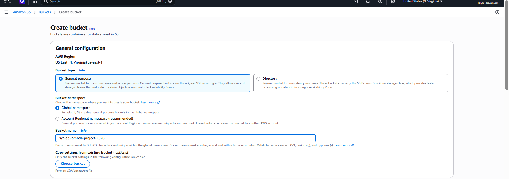
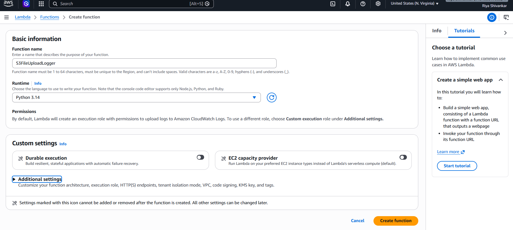
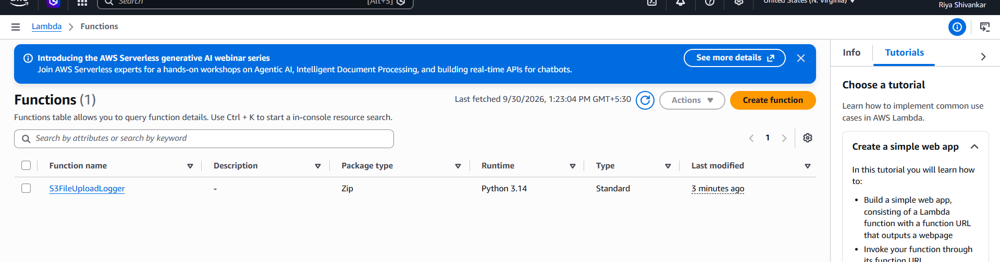
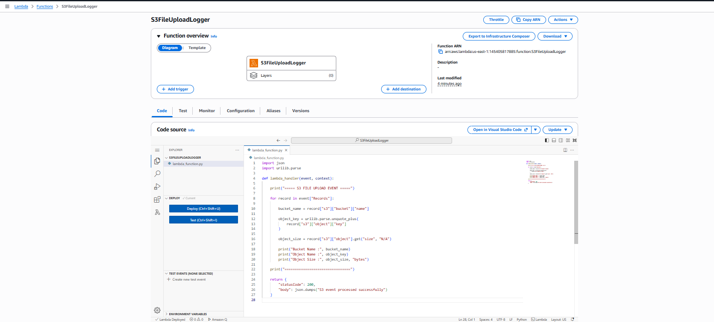
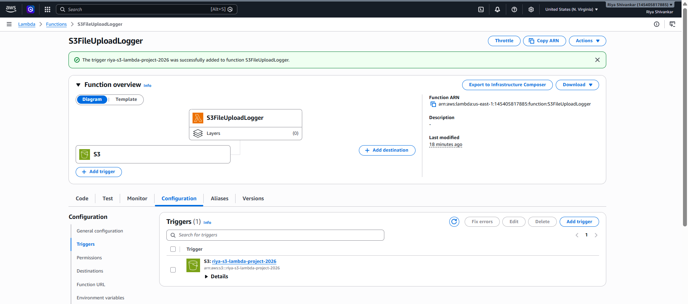
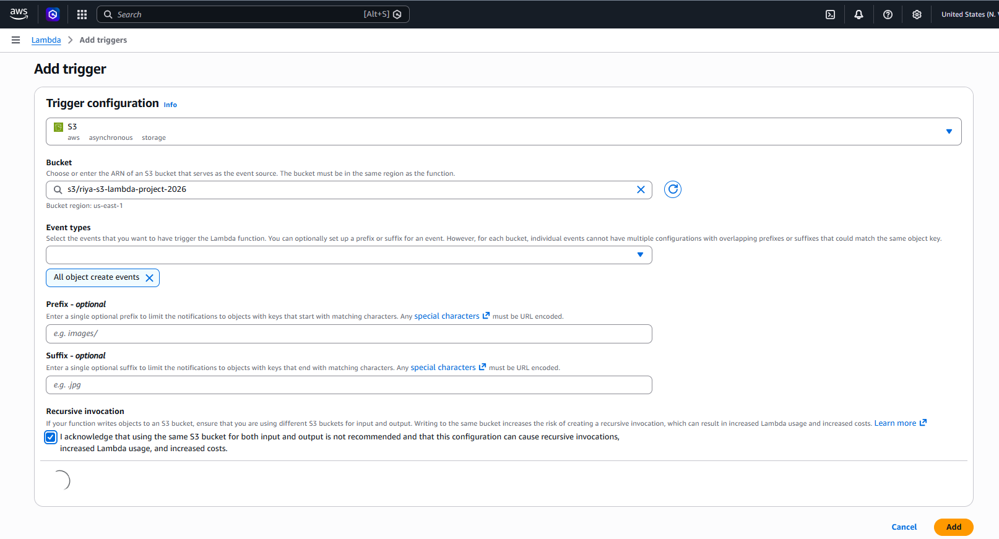
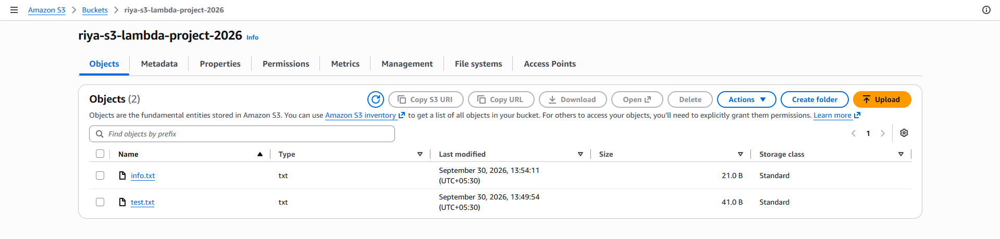
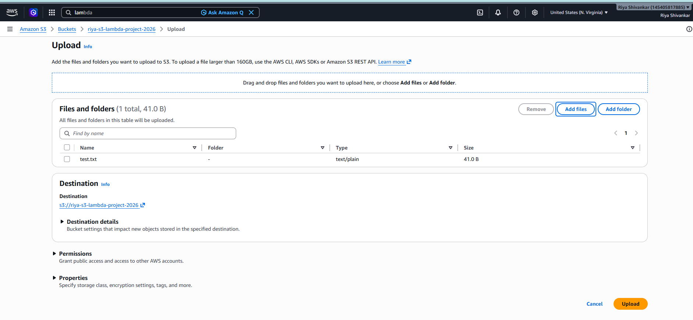
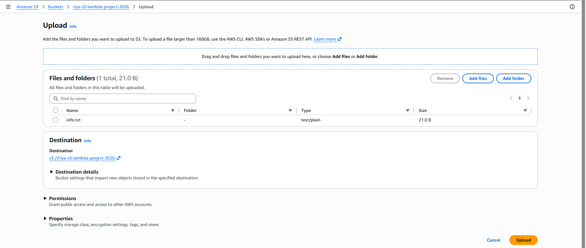
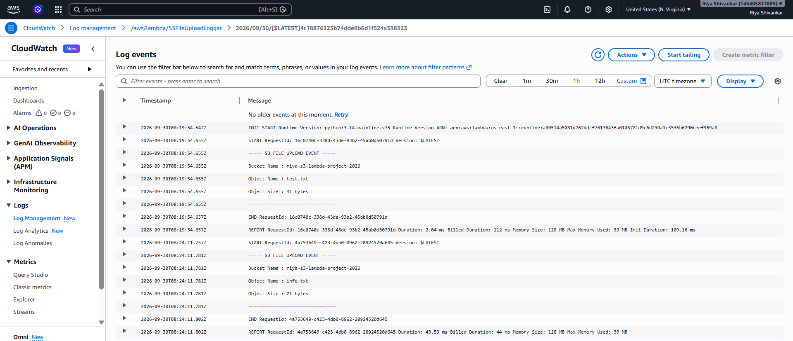

# Project 2 - Event-Driven S3 and Lambda Solution

## 1.Project Objective

The objective of this project is to create an event-driven AWS solution using Amazon S3 and AWS Lambda.
Whenever a file is uploaded to an Amazon S3 bucket, the upload event automatically triggers an AWS Lambda function. The Lambda function captures the S3 bucket and object details and records them in Amazon CloudWatch Logs.

## 2.AWS Services Used

- Amazon S3 - Stores uploaded files and generates upload events
- AWS Lambda - Processes the S3 upload event
- Amazon CloudWatch Logs - Stores Lambda execution logs

## 3.Architecture

The architecture of the project is:

                   
                   
                             User
                               |
                               │Upload File  
                               │ 
                               ▼
                    ┌─────────────────────┐
                    │    Amazon S3        │
                    │                     │
                    │    Bucket           │
                    └──────────┬──────────┘
                               │ObjectCreated Event
                               │ 
                               ▼
                    ┌─────────────────────┐
                    │    AWS Lambda       │
                    │                     │
                    │    S3FileUpload     │
                    │                     │
                    │    Logger           │
                    └──────────┬──────────┘
                               │Log Details 
                               │ 
                               ▼
                    ┌─────────────────────┐
                    │    CloudWatch       │
                    │                     │
                    │    Logs             │
                    |_____________________|
                   

## 4.S3 Configuration

Bucket Name:
riya-s3-lambda-project-2026

AWS Region:
United States(N.Virginia)

Block Public Access:
Enabled

Object Ownership:
Default

Encryption:
Default Amazon S3 encryption.

The S3 bucket is used as the input source for the Lambda function.
## 5.Lambda Function Configuration

Function Name : S3FileUploadLogger

Runtime : Python 3.14

Architecture: x86_64

Execution Role: Lambda basic execution role

The Lambda function receives the S3 event and extracts the 
following information:

Bucket name

Object name

Object size

## 6.Lambda Function Code

    import json

    import urllib.parse

    def lambda_handler(event, context):

    print("===== S3 FILE UPLOAD EVENT =====")

    for record in event["Records"]:

        bucket_name = record["s3"]["bucket"]["name"]

        object_key = urllib.parse.unquote_plus(
            record["s3"]["object"]["key"]
        )

        object_size = record["s3"]["object"].get("size", "N/A")

        print("Bucket Name :", bucket_name)
        print("Object Name :", object_key)
        print("Object Size :", object_size, "bytes")

    print("================================")

    return {
        "statusCode": 200,
        "body": json.dumps("S3 event processed successfully")
    }

and prints these details to CloudWatch Logs.

## 7. S3 Trigger Configuration
An Amazon S3 trigger was added to the Lambda function.
#### Trigger Configuration
Trigger Source:
Amazon S3

Bucket:
riya-s3-lambda-project-2026

Event Type:
All object create events

The trigger automatically invokes the Lambda function whenever a new file is uploaded to the S3 bucket.

Recursive Invocation :
The recursive invocation acknowledgement checkbox was selected.

The Lambda function only reads the S3 event and writes information to CloudWatch Logs. It does not upload or create another object in the same S3 bucket.
Therefore, the Lambda function does not create a continuous recursive S3 → Lambda → S3 loop.

## 8. CloudWatch Logs Configuration
AWS Lambda automatically creates a CloudWatch Logs group for the function.
Log Group
/aws/lambda/S3FileUploadLogger

The Lambda function records the following information:

===== S3 FILE UPLOAD EVENT =====

Bucket Name : riya-s3-lambda-project-2026

Object Name : test.txt

Object Size : 41 bytes

================================

The CloudWatch log also contains the standard Lambda execution messages such as:

START

END

REPORT
## 9. Testing 

#### First Test
Step 1 — Create Test File
A file named : test.txt

was created on the local computer.

Step 2 — Upload File to S3

The test.txt file was uploaded to the configured S3 bucket.

Step 3 — Lambda Invocation

After the upload, Amazon S3 generated an ObjectCreated event.
The event automatically triggered the Lambda function.

Step 4 — Check CloudWatch Logs

The Lambda execution logs were opened in Amazon CloudWatch.
The logs displayed the uploaded file details.

#### Expected Result:

===== S3 FILE UPLOAD EVENT =====

Bucket Name :  riya-s3-lambda-project-2026

Object Name : test.txt

Object Size : 41 bytes

================================

#### Second Test
Step 1 — Create Info File

A second file named : info.txt

was uploaded to the same S3 bucket.

Step 2 — Upload File to S3

The info.txt file was uploaded to the configured S3 bucket.

Step 3 — Lambda Invocation

After the upload, Amazon S3 generated an ObjectCreated event.
The event automatically triggered the Lambda function.

Step 4 — Check CloudWatch Logs

The Lambda execution logs were opened in Amazon CloudWatch.
The logs displayed the uploaded file details.

#### Expected Result:

===== S3 FILE UPLOAD EVENT =====

Bucket Name :  riya-s3-lambda-project-2026

Object Name : info.txt

Object Size : 21 bytes

================================

This confirmed that the Lambda function responds to multiple S3 file upload events.

## 10. Testing Results

         Test     	               Expected Result	           
     S3 bucket creation 	  -  Bucket created successfully	 
     Lambda function creation -  Function created successfully	
     S3 trigger configuration -  S3 connected to Lambda	
     Upload test.txt	      -  Lambda triggered automatically	
     CloudWatch logging	Bucket-  Passed 
     & object detail displayed	
     Upload info.txt	      -   Lambda triggered again	

## 11. Screenshots
The following screenshots were captured as evidence of the project implementation.

S3 Bucket :

Lambda Function Creation :
 

S3FileUploadLogger Lambda Function Code :

Lambda S3FileUploadLogger :

S3 Lambda Trigger :

S3 Files Uploaded :

CloudWatch Logs test.txt :

CloudWatch Logs info.txt :

Cloudwatch Log Event :

## 12. Complete Event Flow
     
         1. User uploads test.txt
                  ↓
         2. Amazon S3 stores the file
                  ↓
         3. S3 generates ObjectCreated event
                  ↓
         4. Lambda function is triggered
                  ↓
         5. Lambda reads bucket and object details
                  ↓
         6. Lambda writes details to CloudWatch Logs
                  ↓
         7. User verifies the event in CloudWatch

## 13. Configuration Summary
     
         Configuration	                      Value
           S3 Bucket	     -   riya-s3-lambda-project-2026
           AWS Region	     -   United States  (N.Virginia)
           Lambda Function	 -   S3FileUploadLogger
           Runtime	         -   Python 3.14
           S3 Event	         -   All object create events
           Log Group	     -   /aws/lambda/S3FileUploadLogger
           Test Files	     -   test.txt, info.txt

## 14. Project Outcome
The project successfully demonstrates an event-driven AWS solution using Amazon S3 and AWS Lambda.
When a file is uploaded to the S3 bucket, the S3 ObjectCreated event automatically triggers the Lambda function. The Lambda function processes the event and records the bucket name, object name, and object size in CloudWatch Logs.

The complete architecture is:

Amazon S3 → AWS Lambda → Amazon CloudWatch Logs

## 15. Conclusion

This project demonstrates how Amazon S3 and AWS Lambda can be integrated to create an event-driven serverless solution.

The project successfully demonstrates:

- Amazon S3 file storage

- S3 ObjectCreated events

- AWS Lambda automatic invocation

- CloudWatch logging

- Event-driven architecture

- End-to-end testing

- Project Status: Completed

